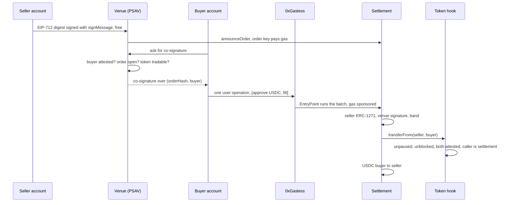

# Architecture

How Handoff is put together, what each party can do, and where the trust sits. The [README](../README.md) has the addresses and transaction links; the spec is [issue #1](https://github.com/nicolasLuduena/unchained-by-txpipe/issues/1).

## Parts

| Part | Where | Run by, in production | Run by, in the demo |
|---|---|---|---|
| Registry, wrapper token, settlement | `contracts/src/` | The DLT entity named in the issuance document, or the PSAV | The team, on Fuji |
| Attestation store | `contracts/src/vendor/kumply/` | Each PSAV attests its own users in this format | The team's own instance of KUMPLY's contract. Demo attestations, no identity check |
| Wallet screen | `web/src/app/_wallet/` | Embedded by the PSAV under its brand | Fictional host wallet "Billetera Sur" |
| Order book and co-signature | `web/src/lib/orders/` | The participating PSAVs | One in-memory instance, labelled as the PSAV's |
| Sponsorship | `web/src/lib/sponsor/` | The PSAV's own 0xGasless key | The team's key and gas tank |
| Registry report | `web/src/lib/registry-report/` | Optional client for BYMA or a PSAV ledger | Labelled mock, no live call |
| Issuer and PSAV console | `web/src/app/console/` | Authenticated desk tool | Run locally, no auth |

## A fill

Tokens stay in the seller's account until the fill. There is no escrow, because a market contract holding clients' tokens would be custody. The settlement contract holds zero of everything after a fill. Tokens move first, so a refused receiver reverts before any USDC moves.

## Where each rule is enforced

| Rule | Enforced by | Error |
|---|---|---|
| Sender and receiver attested | Token hook, through `isAttested` | `SenderNotAttested`, `ReceiverNotAttested` |
| Transfers only through settlement | Token hook | `NotRoutedThroughVenue` |
| Executed by an allowlisted venue | Settlement, venue co-signature against `venueKey` | `InvalidVenueSignature`, `VenueNotAllowed` |
| Price band and floor | Settlement | `PriceOutOfBand`, `PriceStale`, `BandNotSet` |
| At most five venues | Registry | `VenueCapReached` |
| Registration needs an authorization reference and a business issuer | Registry | `MissingAuthorizationRef`, `IssuerNotBusiness` |
| Pause, block | Registry state, read by the hook | `TokenPaused`, `SenderBlocked` |

The app repeats some of these so a user gets a readable message before signing. Those checks are courtesy; the contracts decide.

The hook accepts tiers 2 to 5, so persons, businesses and agents can hold. Tier 1 cannot. `registerToken` needs tier 4 exactly.

## Attestation store

`HandoffRegistry` takes one `issuerAttester` as an immutable constructor argument, used for the business check in `registerToken`. Each token has its own attester set, used for the holder checks, which the issuer changes with `setAttester`. On Fuji both point at the team's store, `0x94b711809FDb5dcFdD2eD488EE10790DaFdC1c10`.

Swapping to KUMPLY's official store means redeploying the registry, and then the settlement and token, whose `registry` is immutable. Moving only the holder checks of an existing token is one `setAttester` call by the issuer, but it leaves the registration check on the team's store. Neither was done, and the demo accounts hold no attestation on the official store.

## Keys and trust

| Key | Can do | Held by, in the demo |
|---|---|---|
| Registry owner | `setSettlement`, `repointVenue` | Deployer EOA. A multisig of issuer and PSAVs is a production note |
| Issuer | Venues, attesters, band, floor, mint, pause | EOA, on the console's server side |
| Venue | `revertToPaper`, `setBlocked`, band, pause | EOA, on the console's server side |
| Order key | `announceOrder`, co-sign fills; an order uses its own venue's key | Server env `VENUE_ORDER_KEY`, `VENUE_ORDER_KEY_2` |
| Seller and buyer owners | Sign for their smart accounts | App server on Fuji, behind the sponsor route. A demo shortcut: in production these belong to the user's wallet |
| Paymaster key | Spend sponsorship | Server file, read by path, never `NEXT_PUBLIC` |

The paymaster does not read attestations; the hook does. [`fuji-server.ts`](../web/src/lib/sponsor/fuji-server.ts) refuses anything but the two demo accounts and the wallet's own calls, to protect the credit.

## What the signature work found

[`spike/README.md`](../spike/README.md) has the detail. The parts that shaped the code:

- The SDK has no typed-data signing, so the digest is computed first and signed with `signMessage(digest)`, and settlement verifies through OpenZeppelin `SignatureChecker`.
- An undeployed account signs an ERC-6492 blob, which `SignatureChecker` rejects, so the account must exist before an order is signed.
- The SDK caches `NOT_DEPLOYED`, so a fresh client is built after the first operation.
- The module does not bind a signature to one account, so `Order.seller` must stay in the signed type.

## Local and Fuji

`NEXT_PUBLIC_CHAIN` selects `deployments/<chain>.json`. On `local`, `DeployLocal.s.sol` deploys stubs for the store and USDC, and the `Sponsor` seam signs with anvil keys, with no bundler or paymaster. On `fuji`, the same seam goes to the server route and 0xGasless.
